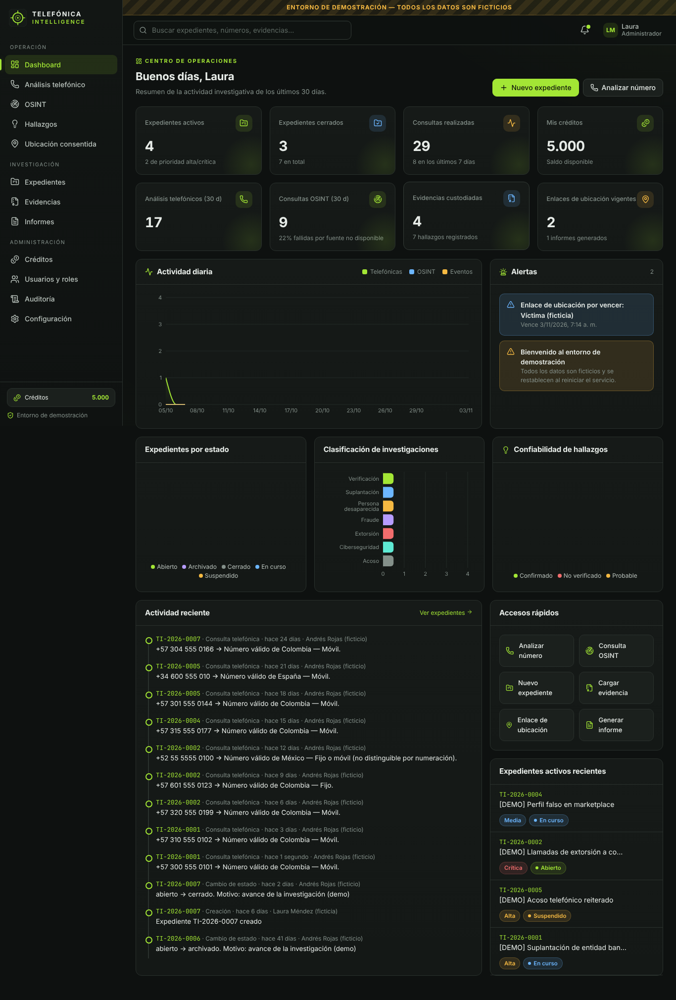

# TELEFÓNICA INTELLIGENCE

Plataforma privada de investigación y análisis telefónico basada **exclusivamente en fuentes legítimas**: planes de numeración públicos, registros abiertos (DNS, RDAP, Certificate Transparency, Internet Archive) y datos aportados con consentimiento expreso.

> Proyecto independiente. El nombre usa "telefónica" como adjetivo descriptivo ("inteligencia telefónica"); **no está afiliado a Telefónica S.A. ni a ninguna de sus marcas**.



## Qué incluye

| Módulo | Funciones principales |
|---|---|
| **Dashboard** | Indicadores, gráficos de actividad, alertas, actividad reciente, accesos rápidos |
| **Análisis telefónico** | Normalización E.164, validación, país, prefijo, longitud, tipo de línea, región (cuando hay fuente pública), análisis por lote, historial, exportación CSV/JSON |
| **OSINT** | DNS, RDAP/WHOIS, certificados y subdominios, historial web, verificación de enlaces y metadatos, IP, búsqueda pública asistida. Cada resultado con fuente, fecha y confiabilidad |
| **Hallazgos** | Confirmado / Probable / No verificado, con fuente obligatoria |
| **Ubicación con consentimiento** | Enlaces únicos con vencimiento, consentimiento informado, permiso del navegador, mapa, revocación y borrado por la propia persona |
| **Expedientes** | Código único, entidades, números, observaciones, estados con motivo, historial inalterable, búsqueda y filtros |
| **Evidencias** | Cifrado AES-256-GCM en reposo, SHA-256 (navegador + servidor), cadena de custodia, verificación de integridad, inventario |
| **Informes PDF** | Resumen, objetivo, consultas, resultados, fuentes, evidencias, observaciones, limitaciones, conclusiones, registro de integridad |
| **Créditos** | Saldo, costo por operación configurable, asignación manual, historial (sin pagos reales) |
| **Usuarios y seguridad** | Roles y permisos editables, scrypt, 2FA TOTP con códigos de recuperación, bloqueo por intentos, CSRF, auditoría |
| **Configuración** | Perfil, preferencias, parámetros, fuentes, retención, copias de seguridad cifradas, información del sistema |

## Inicio rápido (sin programar)

1. Instale **Node.js 22 LTS** (22.13 o superior) desde <https://nodejs.org>.
2. Descargue este proyecto y abra la carpeta.
3. Haga doble clic en:
   - **Windows:** `iniciar.bat`
   - **macOS:** `iniciar.command`
   - **Linux:** `./iniciar.sh`
4. La primera vez se instalan dependencias, se compila la interfaz y se crea `.env` con una **clave maestra aleatoria**. El navegador se abre en <http://127.0.0.1:8080>.
5. Cree la cuenta de administrador en el asistente de configuración inicial.

> **Guarde una copia de `MASTER_KEY` (archivo `.env`) fuera del equipo.** Sin ella no se pueden descifrar evidencias, informes ni copias de seguridad.

### Acceso desde el celular u otro computador (dirección pública HTTPS)

Haga doble clic en **`iniciar-publico.bat`** (Windows) o **`iniciar-publico.command`** (macOS). La primera vez descarga el conector gratuito de Cloudflare. En la ventana aparecerá una dirección como `https://palabras-aleatorias.trycloudflare.com`: ábrala desde cualquier celular o computador. Los enlaces de ubicación con consentimiento usarán esa dirección y funcionarán en celulares.

- Los datos siguen guardados en su computador; debe mantener el equipo encendido y la ventana abierta.
- La dirección **cambia cada vez** que reinicia. Para una dirección fija se necesita un dominio propio (ver Manual técnico).
- Active la verificación en dos pasos, porque la página queda accesible desde Internet.

### Búsqueda automática de información pública

Menú **Investigar número**: escribe el número, pulsa *Investigar* y obtiene el análisis y las páginas de Internet donde aparece publicado (en sus distintos formatos), con fuente y fecha, guardados en un expediente. Para los resultados automáticos, un administrador registra una clave **gratuita** de Brave Search en *Configuración › Fuentes* (crearla en <https://api-dashboard.search.brave.com>, plan Free).

### Entorno de demostración (datos ficticios)

```bash
./iniciar.sh demo        # Windows: iniciar.bat demo
```

Se abre en <http://127.0.0.1:8081> con cuentas de prueba (`admin.demo` / `Demo2026admin`, `analista.demo` / `Demo2026analista`, `consultor.demo` / `Demo2026consultor`). Usa una base de datos separada (`data-demo/`) que se **reinicia en cada arranque**.

## Comandos

| Comando | Uso |
|---|---|
| `npm run setup` | Instala, compila y genera `.env` |
| `npm start` / `npm run start:demo` | Inicia el entorno privado / de demostración |
| `npm run dev` | Desarrollo con recarga (backend 8080 + Vite 5173) |
| `npm test` | Pruebas de API y unitarias |
| `npm run test:e2e` | Pruebas en navegador (requiere Playwright) |
| `npm run backup` | Copia de seguridad cifrada |
| `npm run restore -- archivo.tibak --confirmar` | Restaurar (con la aplicación detenida) |
| `npm run reset-admin -- usuario` | Recuperación de emergencia de un administrador |
| `npm run check-secrets` | Verifica que no haya secretos en el repositorio |

## Actualizar

```bash
git pull
npm install
npm run build
```

Reinicie la aplicación. Las migraciones de base de datos se aplican solas. Haga una copia (`npm run backup`) antes de actualizar.

## Documentación

- [Manual de usuario](docs/MANUAL_USUARIO.md)
- [Manual técnico](docs/MANUAL_TECNICO.md) (instalación en servidor, HTTPS, variables, respaldo)
- [Arquitectura y decisiones técnicas](docs/ARQUITECTURA.md)
- [Informe de pruebas](docs/INFORME_PRUEBAS.md)
- [Limitaciones identificadas](docs/LIMITACIONES.md)
- [Historial de cambios](CHANGELOG.md)

## Uso responsable

La plataforma **no** realiza rastreo clandestino, interceptación de comunicaciones, acceso a bases privadas de operadores, acceso a cuentas, ni obtención de ubicación sin consentimiento. El usuario es responsable de cumplir la legislación aplicable de protección de datos personales (en Colombia, Ley 1581 de 2012 y normas concordantes).
